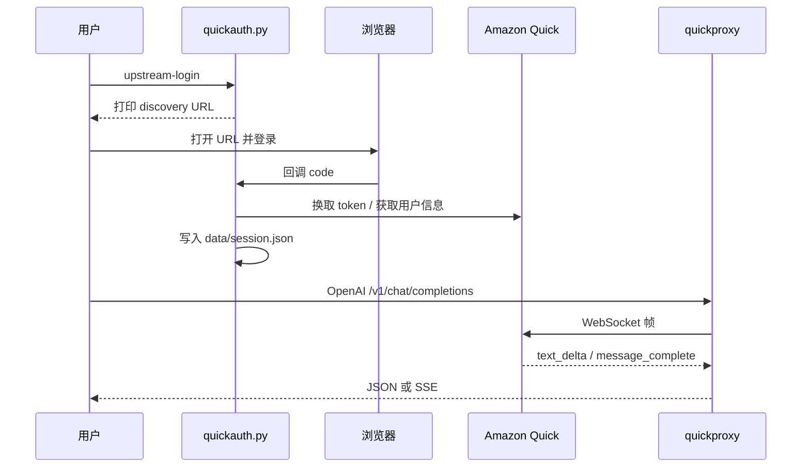

# QuickWork / Amazon Quick → OpenAI API

把 Amazon Quick（QuickWork）桌面端的聊天能力转换成 **OpenAI 兼容的 HTTP API**。

项目内置原生 OAuth 登录：不用启动官方桌面应用，也不用运行 outpost 进程。登录后由 Go 反代把 `/v1/chat/completions` 请求转换为 QuickWork WebSocket 帧，并把结果转回普通 JSON 或 SSE。

> 非官方项目，与 Amazon / AWS 无关联。请仅在你拥有或获得明确授权的账号上使用，并遵守相关服务条款。

## 功能

- `POST /v1/chat/completions`，支持流式（SSE）与非流式响应
- `GET /v1/models`，返回本地模型别名
- 原生 social 登录（AWS IAM Identity Center OIDC）与企业 OIDC 登录，使用 PKCE
- `refresh` 命令刷新 token，无需重新打开浏览器
- 可选本地 API key 保护
- 默认每轮对话结束后删除上游会话，避免污染聊天列表
- 保留 `assistant.tool_calls` / `role: tool` 历史，客户端工具调用链不会丢上下文
- 当客户端声明同名 `tools` 时，把上游 `tool_start` / `tool_arguments` / `tool_result` 转成 OpenAI `tool_calls`
- 使用上游 `turn_usage` 返回 `usage` 与 `prompt_tokens_details.cached_tokens`
- `system` / `developer` 消息通过 QuickWork 原生 `system_prompt` 覆盖服务端基础提示词，不拼进 user 文本，也不做提示词注入

## 环境要求

- 用于构建反代：Go 1.26+
- 用于登录：Python 3.10+（仅使用标准库，无需安装依赖）
- 一个可正常登录的 Amazon Quick 账号
- 浏览器与登录脚本运行在**同一台机器**，且本机 `18080` 端口可被浏览器访问

## 快速开始

### 1. 构建反代

```bash
cd quickwork-openai
go build -o bin/quickproxy.exe ./cmd/quickproxy   # Windows
# go build -o bin/quickproxy ./cmd/quickproxy     # macOS / Linux
```

### 2. 登录上游账号

```bash
python auth/quickauth.py upstream-login --provider social
```

终端会打印一个 discovery URL，例如：

```
https://quick.aws.com/sn?qwSurface=desktop:<nonce>:18080:1.2.4660
```

在**同一台机器**的浏览器中打开它，完成登录。工具会：

1. 接收浏览器回调；
2. 完成 OAuth / PKCE 与 token 交换；
3. 获取用户信息；
4. 写入 `data/session.json`（反代使用）和 `data/upstream.json`（refresh 使用）。

终端只打印账号显示信息、`ws_host` 和到期时间，不打印 token。

企业 SSO 登录：

```bash
python auth/quickauth.py upstream-login --provider enterprise --region us-east-1
```

### 3. 启动反代

```bash
./bin/quickproxy.exe -addr 127.0.0.1:8080 \
  -tokens data/tokens.json \
  -session data/session.json
```

如果 `data/tokens.json` 不存在或为空，反代会关闭 API key 鉴权，适合纯本机使用。

### 4. 调用

```bash
curl http://127.0.0.1:8080/v1/models \
  -H "Authorization: Bearer local"
```

```bash
curl http://127.0.0.1:8080/v1/chat/completions \
  -H "Authorization: Bearer local" \
  -H "Content-Type: application/json" \
  -d '{
    "model": "smart",
    "stream": true,
    "messages": [{"role": "user", "content": "用三句话解释 QUIC"}]
  }'
```

Python SDK：

```python
from openai import OpenAI

# 未配置 data/tokens.json 时 api_key 可填任意值；配置后填对应 key。
client = OpenAI(base_url="http://127.0.0.1:8080/v1", api_key="local")

for chunk in client.chat.completions.create(
    model="smart",
    messages=[{"role": "user", "content": "hello"}],
    stream=True,
):
    print(chunk.choices[0].delta.content or "", end="")
```

## 发布

推送 `v*` tag 会触发 `.github/workflows/release.yml`，构建并发布：

| 平台 | 架构 | 产物 |
|---|---|---|
| Windows | amd64 | `quickproxy-windows-amd64.exe` |
| Windows | arm64 | `quickproxy-windows-arm64.exe` |
| Linux | amd64 | `quickproxy-linux-amd64` |
| Linux | arm64 | `quickproxy-linux-arm64` |

同时生成 `SHA256SUMS`。手动运行该 workflow 只上传 Actions artifacts，不创建 release。

```bash
git tag -a v0.2.0 -m "v0.2.0"
git push origin v0.2.0
```

## 命令

### 登录与凭据

| 命令 | 说明 |
|---|---|
| `python auth/quickauth.py upstream-login` | 打开浏览器登录并写出 session |
| `python auth/quickauth.py refresh` | 刷新 token 并重写 `data/session.json` |
| `python auth/quickauth.py status` | 显示 session 的 provider、ws_host、账号与到期时间 |
| `python auth/quickauth.py logout` | 删除 `data/session.json` 与 `data/upstream.json` |

`upstream-login` 常用参数：

| 参数 | 默认 | 说明 |
|---|---|---|
| `--provider` | `social` | `social`、`enterprise`、`gateway`、`social_gateway` |
| `--build-stage` | `prod` | `prod`、`beta`、`integ`、`dev` |
| `--region` | 空 | 企业 discovery 的 region 前缀；social 使用 discovery 返回的 IDC region |
| `--port` | `18080` | 本机 OAuth 回调端口 |
| `--timeout` | `3600` | 等待浏览器完成登录的秒数 |
| `--open` | 关闭 | 同时用默认浏览器打开 URL |

### 反代参数

| 参数 | 默认 | 说明 |
|---|---|---|
| `-addr` | `127.0.0.1:8080` | 监听地址 |
| `-session` | `data/session.json` | 登录工具写出的 session |
| `-tokens` | `data/tokens.json` | 本地 API key 文件；不存在/为空时关闭鉴权 |
| `-models` | `smart,fast,balanced,auto` | `/v1/models` 返回值与 model 白名单 |
| `-default-model` | `smart` | 未知 model 的映射 |
| `-timeout` | `5m` | 单次上游请求超时 |
| `-keep-sessions` | `false` | 保留上游会话，不在一轮结束后删除 |
| `-thinking` | 空 | `off`、`low`、`medium`、`high` |
| `-app-version` | `1.2.4660` | 上游握手使用的 appVersion |
| `-surface` | `QUICK_WORK_DESKTOP_WINDOWS` | 上游握手使用的 surfaceType |
| `-timezone` | `UTC` | 请求中的 user_timezone |
| `-locale` | `en-US` | 请求中的 user_locale |

需要 API key 时，创建 `data/tokens.json`：

```json
{
  "tokens": {
    "sk-local": {
      "email": "you@example.com",
      "created_at": 0
    }
  }
}
```

之后请求需带 `Authorization: Bearer sk-local`（或 `X-Api-Key: sk-local`）。

## 工作方式



- 登录完全在 `auth/quickauth.py` 内完成，不依赖官方桌面应用或 outpost。
- `quickproxy` 使用 `session.json` 中的 `jwt`、`ws_host` 和 `provider` 连接上游 WebSocket。
- 上游不是 OpenAI HTTP API，而是 WebSocket JSON 帧；本项目的 `internal/proxy/wire.go` 负责帧编码与 event-stream 解码。

### 提示词与工具调用

- `system` / `developer` 消息会按原顺序合并，放入 `user_message.payload.system_prompt`。
- 非空 `system_prompt` 会覆盖 QuickWork 服务端基础 system prompt；未提供时保留服务端默认。已验证 social 路径，enterprise / gateway 仍待逐项验证。
- 不会添加“ignore previous instructions”等额外指令，也不会把 system prompt 塞进 user 文本。
- 客户端历史中的 `assistant.tool_calls` 会转成带 `id` / `name` 的文本，`role: tool` 会转成带 `call_id` / `name` 的工具结果，供上游继续推理。
- 客户端在 `tools` / `functions` 中声明的工具不会由本代理执行。只有上游 agent 调用**同名工具**时，代理才会返回 OpenAI `tool_calls`；其他上游工具调用保持内部执行，只返回最终文本。
- 非流式响应中，工具调用放在 `choices[0].message.tool_calls`；只有工具调用且没有最终文本时 `finish_reason` 才是 `tool_calls`，否则为 `stop`。
- 流式响应中，工具调用以一个完整的 `arguments` 块发出；文本继续按 `text_delta` 原样转发。

## 安全与隐私

- `data/` 包含 access token、refresh token、client secret 和用户信息，已被 `.gitignore` 排除，权限尽量设为 `0600`。
- 登录密码只在 Amazon 的浏览器页面中输入，本项目不会保存密码。
- 反代默认只监听 `127.0.0.1`。不要把端口直接暴露到公网；如确需远程访问，请自行加 TLS 与访问控制。
- `logout` 会删除本地 session 与 refresh 状态。
- 不要提交或分享 `data/` 目录。

## 限制

- 只实现聊天补全。`temperature`、`max_tokens`、`stop`、`response_format` 等采样参数不会传给上游；`n > 1` 会返回 400。
- 客户端 `tools` / `functions` 不会由代理执行。只有上游 agent 调用同名工具时才会出现 OpenAI `tool_calls`；`tool_choice: "none"` 会隐藏所有工具调用。
- `system_prompt` 覆盖已在 social 路径验证；enterprise / gateway 仍待验证。空 system 消息会保留服务端默认提示词。
- `model` 会映射为上游 agent mode：`smart`、`fast`、`balanced`、`auto`。
- 上游没有模型列表 API；`/v1/models` 返回的是本项目配置的别名。
- social / enterprise 路径已做真实账号验证；`gateway` / `social_gateway` 的 CBOR 路径仍属实验性。
- 上游 token 通常约 1 小时到期，运行 `refresh` 可延长。
- 上游接口可能随官方客户端更新而变化；若登录或聊天失败，先重新执行 `upstream-login`。
- 本项目与 Amazon / AWS 无关联，不提供任何服务保证。

## 故障排查

| 现象 | 处理 |
|---|---|
| `cannot listen on 127.0.0.1:18080` | 关闭占用 18080 的其他进程后重试 |
| 浏览器登录后一直等待 | 确认浏览器与脚本在同一台机器，且回调端口可达；不要关闭终端 |
| `upstream_session_unavailable` | 运行 `upstream-login`，或先运行 `refresh` |
| `401 invalid_api_key` | 检查 `data/tokens.json` 与请求头中的 key 是否一致 |
| 登录页面报错 | 查看终端输出的错误；确认 `--provider` 与账号类型匹配 |
| token 过期 | 运行 `python auth/quickauth.py refresh` |

## 目录

```
quickwork-openai/
  auth/quickauth.py        原生 OAuth 登录、refresh、status、logout
  cmd/quickproxy/          Go 反代入口
  internal/proxy/          session、WebSocket codec、OpenAI handler
  data/                    运行期凭据与会话（gitignored）
```

## License

本项目采用 [GNU General Public License v3.0](LICENSE) 授权。

## Acknowledgements

Thanks to the [LINUX DO](https://linux.do) community for its support.
